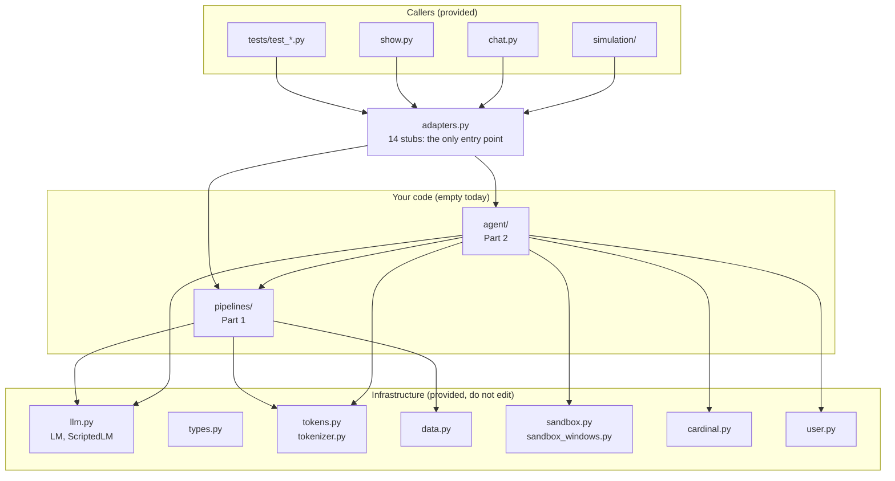
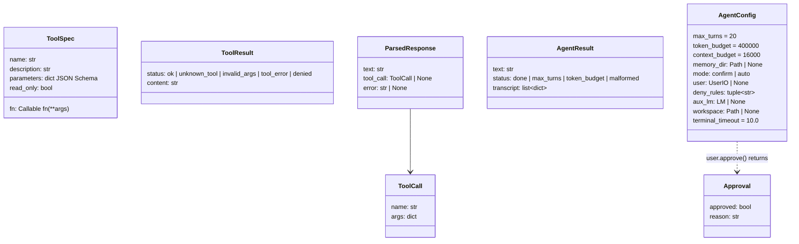
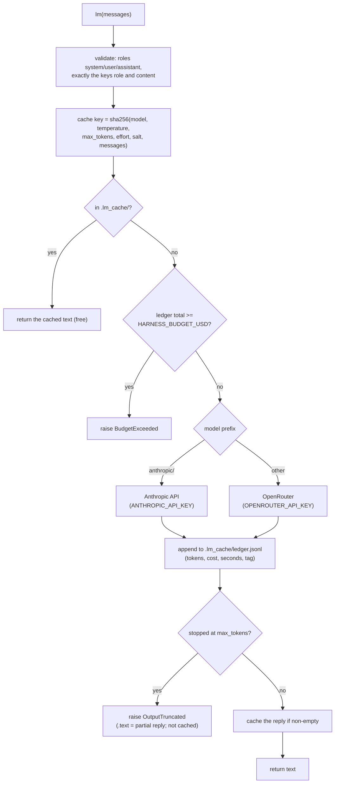
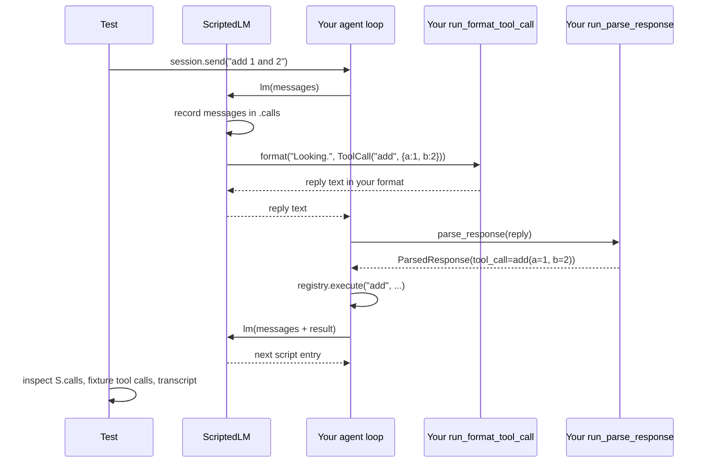
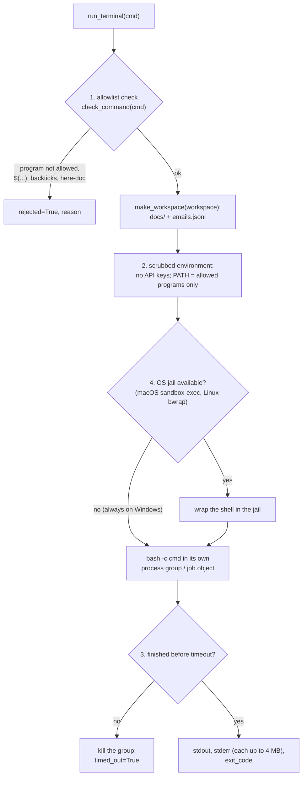
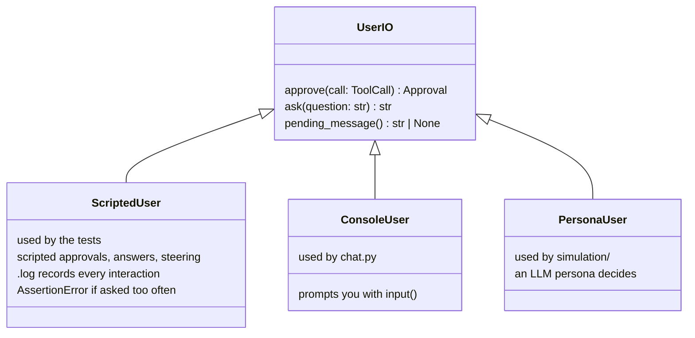
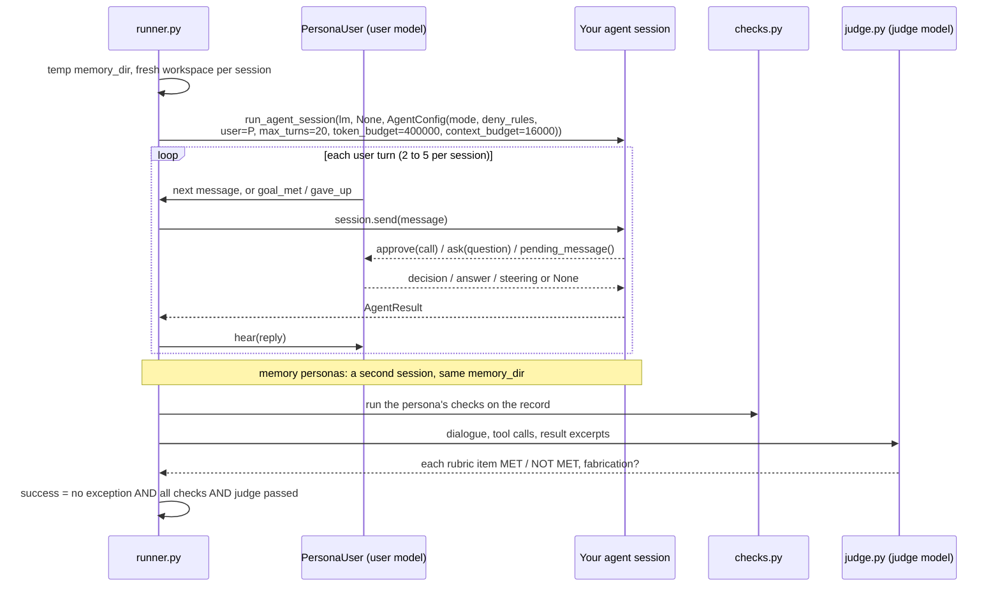
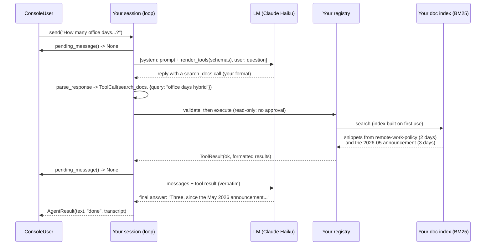

# Codebase: How the Existing Code Works

This page explains the code that already exists: what each module does, how
the pieces call each other, and where your code plugs in. For what you have
to build, read [OVERVIEW.md](OVERVIEW.md). For per-module reference tables,
read [GUIDE.md](GUIDE.md).

## Contents

1. [The big picture](#1-the-big-picture)
2. [Directory map](#2-directory-map)
3. [`adapters.py`: the seam](#3-adapterspy-the-seam)
4. [`types.py`: the shared vocabulary](#4-typespy-the-shared-vocabulary)
5. [`llm.py`: the one model primitive](#5-llmpy-the-one-model-primitive)
6. [`tokens.py` and `tokenizer.py`](#6-tokenspy-and-tokenizerpy)
7. [`data.py`: the corpora](#7-datapy-the-corpora)
8. [`sandbox.py`: the terminal](#8-sandboxpy-the-terminal)
9. [`cardinal.py`: the fixed toolset](#9-cardinalpy-the-fixed-toolset)
10. [`user.py`: the human interface](#10-userpy-the-human-interface)
11. [`chat.py` and `show.py`: the tools you run](#11-chatpy-and-showpy)
12. [`simulation/`: the final evaluation](#12-simulation-the-final-evaluation)
13. [`tests/`: how the tests drive your code](#13-tests-how-the-tests-drive-your-code)
14. [End to end: one request through the system](#14-end-to-end-one-request-through-the-system)
15. [Where your code goes](#15-where-your-code-goes)

---

## 1. The big picture

The repository is a finished frame with a hole in the middle. Everything
around the hole works today. The hole is
[harness/adapters.py](../harness/adapters.py): 14 functions that raise
`NotImplementedError`, plus the empty `pipelines/` and `agent/` packages.



Three ideas hold the design together:

1. **One narrow seam.** Every caller reaches your code only through
   `adapters.py`, so you can organize your package however you like.
2. **One model primitive.** Every model, real or fake, is a callable
   `lm(messages) -> str`. Your code never knows which kind it got.
3. **Fakes for everything outside.** `ScriptedLM` replaces the model and
   `ScriptedUser` replaces the person, so most tests run offline and
   deterministically.

## 2. Directory map

```
agent-harness/
├── harness/                    the Python package
│   ├── adapters.py             THE SEAM: 14 stubs you replace           (yours)
│   ├── pipelines/              empty: suggested home for Part 1         (yours)
│   ├── agent/                  empty: suggested home for Part 2         (yours)
│   ├── types.py                dataclasses and TypedDicts at the seam
│   ├── llm.py                  LM (cache, ledger, budget), ScriptedLM
│   ├── tokens.py               count_tokens, count_message_tokens
│   ├── tokenizer.py            tokenize() for BM25
│   ├── data.py                 load_emails, emails_on, email_text, load_docs
│   ├── sandbox.py              run_terminal, make_workspace, jail
│   ├── sandbox_windows.py      Windows backend: Git Bash, job objects
│   ├── cardinal.py             names, schemas, read_only flags of the 10 tools
│   ├── user.py                 UserIO, ScriptedUser, ConsoleUser
│   ├── chat.py                 talk to your agent in the terminal
│   ├── show.py                 run one Part 1 pipeline on real data
│   └── simulation/             personas, checks, judge, evaluation runner
├── tests/                      one test file per problem, plus fixtures
├── data/
│   ├── docs/                   24 Cardinal Energy documents
│   ├── emails.jsonl.gz         compressed archive (committed)
│   ├── emails/emails.jsonl     unpacked archive (gitignored)
│   ├── download.py             verify SHA-256 and unpack
│   └── priority_rubric.md      the labeling rubric
├── docs/                       GUIDE.md, OVERVIEW.md, CODEBASE.md, harness.pdf
└── generated at runtime (gitignored): .venv/, .lm_cache/, runs/
```

## 3. `adapters.py`: the seam

Each adapter has a precise type signature and a docstring listing every rule
its tests check. The intended pattern is a one-line body that calls into
your package:

```python
# harness/adapters.py, after you implement problem 1
def run_priority(email: Email, lm: LMCallable) -> dict:
    """... (the docstring stays: it is the spec) ..."""
    from harness.pipelines.priority import classify_priority
    return classify_priority(email, lm)
```

| Adapter | Problem | Called by |
|---|---|---|
| `run_priority` | 1 | tests, `show priority`, `show digest --labels` |
| `run_daily_digest` | 2 | tests, `show digest` |
| `run_bm25_build`, `run_bm25_search` | 3 | tests, `show bm25`, `show email_qa`, and the tests of problem 4 |
| `run_email_qa` | 4 | tests, `show email_qa` |
| `run_tool_registry` | 5 | tests |
| `run_render_tools`, `run_parse_response` | 6 | tests |
| `run_format_tool_call` | 6 | tests, through `ScriptedLM` (section 5.2) |
| `run_agent_session` | 7 to 15 | tests, `chat.py`, `simulation/` |
| `run_build_doc_index`, `run_search_docs`, `run_read_doc` | 9 | tests, `show search_docs` |

Note that the live email_qa test builds its `search` function from **your**
BM25 adapters, so problem 4's live score depends on problem 3:

```python
# tests/test_email_qa.py (simplified)
index = adapters.run_bm25_build([email_text(e) for e in archive])
def search(query: str, k: int = 5) -> list[dict]:
    return [archive[doc_id] for doc_id, _ in adapters.run_bm25_search(index, query, k)]
result = adapters.run_email_qa(question, search, live_lm)
```

## 4. `types.py`: the shared vocabulary

[harness/types.py](../harness/types.py) defines every type that crosses the
seam. TypedDicts are plain dicts (`email["subject"]`); dataclasses have
attributes (`result.status`).



The transcript is a list of event dicts. It is a log, not the model's
context: compaction changes what you send to the model and never removes
events.

```python
{"type": "user",        "content": str}
{"type": "assistant",   "content": str}                       # the raw model reply
{"type": "tool_call",   "name": str, "args": dict}
{"type": "tool_result", "name": str, "status": Status, "content": str}  # exactly what the model saw
{"type": "error",       "content": str}                       # after an unparseable reply
# other types (for example "compaction") are allowed; tests ignore them
```

## 5. `llm.py`: the one model primitive

### 5.1 `LM`: the real model

```python
from harness.llm import LM
lm = LM()                      # role "agent"  -> anthropic/claude-haiku-5-5
judge = LM("judge")            # role "judge"  -> anthropic/claude-sonnet-5-5
lm = LM(max_tokens=8000, tag="my-experiment")
text = lm([{"role": "system", "content": "Answer in one word."},
           {"role": "user", "content": "What color is the sky?"}])
```

What happens inside one call:



| Feature | Detail |
|---|---|
| Roles | `HARNESS_AGENT_MODEL`, `HARNESS_USER_MODEL`, `HARNESS_JUDGE_MODEL` override the defaults. Any other string is used as a model name. |
| Price check | A model missing from the `PRICES` table fails at construction, before any paid call |
| Reasoning effort | `HARNESS_REASONING_EFFORT` (default `low`). Hidden reasoning counts against `max_tokens`, so keep `max_tokens` generous. |
| Exceptions | `BudgetExceeded` (your cap) and `OutputTruncated` (cut off; carries `.text`). The agent loop must treat `OutputTruncated` as a malformed reply. |
| Usage | `lm.usage()` gives this instance's totals; `uv run python -m harness.llm` prints the ledger by model and by tag |
| Concurrency | Safe to call from several threads; the ledger write is locked and cache writes are atomic |

### 5.2 `ScriptedLM`: the fake model

The deterministic tests pass a `ScriptedLM` wherever your code expects
`lm`. It replays a script, one entry per call:

```python
ScriptedLM([
    "a plain string reply",
    {"text": "Looking.", "tool_call": {"name": "add", "args": {"a": 1, "b": 2}}},
    lambda messages: "a reply computed from the messages",
])
```

A scripted tool call is stored as a name and arguments, not as text. To
turn it into text your parser can read, `ScriptedLM` calls **your**
`run_format_tool_call`. That is how one test suite works with any call format
you design:



Two consequences:

- **One script entry = one agent turn.** An extra call through `lm` (for a
  summary, say) consumes an entry, and `ScriptExhausted` is raised when the
  script runs out. That is why every auxiliary call must go to
  `config.aux_lm`, which the tests set to a separate `ScriptedLM`.
- **The tests read `.calls`.** They check what your code sent, for example
  that a tool result appears verbatim in the next call.

## 6. `tokens.py` and `tokenizer.py`

Two tiny modules that every budget and every BM25 score depends on.

```python
count_tokens(text)            == math.ceil(len(text) / 4)
count_message_tokens(msgs)    == sum(count_tokens(m["content"]) + 4 for m in msgs)

tokenize("Re: Q3 gas-price forecast") == ["re", "q3", "gas", "price", "forecast"]
#        lowercase, then maximal runs of [a-z0-9]
```

`count_tokens` is an approximation (4 characters per token), not the
provider's tokenizer. Every budget in the project uses it: `token_budget`,
`context_budget`, the 150-token snippet, the 1,500-token window, and the
6,000-token result limit. Use the same functions in your code so your
numbers match the tests.

## 7. `data.py`: the corpora

```python
from harness import data
emails = data.load_emails()           # 26,278 dicts, sorted by date; read once, cached; do not mutate
day    = data.emails_on("2001-06-22") # a copy of that UTC day's list, or []
text   = data.email_text(email)       # subject + "\n" + body: what BM25 indexes
docs   = data.load_docs()             # 24 dicts {doc_id, title, text}, sorted by doc_id
```

`load_emails()` reads 58 MB on first use, which takes a few seconds. That is
why creating an agent session must not call it (problem 8): build the email
index lazily, the first time a tool needs it.

Line numbers in this project are 1-based positions in
`text.splitlines()`. `read_doc` windows (problem 9) use the same numbering.

## 8. `sandbox.py`: the terminal

`run_terminal(cmd, *, workspace=None, timeout=10.0) -> TerminalResult` runs
one model-written shell command. It never raises for a rejection or a
timeout; it reports them in the result.

```python
@dataclass
class TerminalResult:
    stdout: str = ""
    stderr: str = ""
    exit_code: int | None = None   # None if rejected or timed out
    timed_out: bool = False
    rejected: bool = False
    reason: str = ""               # why it was rejected or killed
```



| Layer | Stops | Does not stop |
|---|---|---|
| 1. Allowlist | Programs not on the list, programs given as paths, `X=1 cmd`, `$(...)`, backticks, `$'...'`, here-docs | Arguments: `python3`, `awk system()`, `find -exec`, `xargs` can run anything; redirections such as `> ~/x` |
| 2. Scrubbed environment | API keys and other environment variables | A program started by an absolute path |
| 3. Timeout and output cap | Runaway time; output beyond 4 MB per stream | Processes that leave the group; memory, CPU, disk |
| 4. OS jail | Network, writes outside the workspace, reads of home and the repository | **Not available on Windows** |

Allowed programs: `python3 python cat head tail grep wc sort uniq cut sed awk
tr ls find jq diff comm paste join nl tee xargs basename dirname date seq
mkdir`, and the builtins `cd echo printf pwd read test [ true false`.

On this machine (Windows), `sandbox.jail()` returns `"none"`. Commands run in
Git for Windows `bash.exe`, a job object replaces the process group, CRLF
output becomes LF, and `emails.jsonl` in the workspace is a read-only hard
link. Because here-docs are rejected, a multi-line script must be written as
`python3 -c '...'`, and your tool description should tell the model so.

## 9. `cardinal.py`: the fixed toolset

[harness/cardinal.py](../harness/cardinal.py) fixes the parts of the ten
Cardinal tools that the tests and personas rely on: names, argument schemas
(all with `additionalProperties: false`), and `read_only` flags. You supply
the description and the function:

```python
from harness.cardinal import cardinal_spec

def search_docs(query: str, k: int = 5) -> str:   # give optional args defaults:
    ...                                            # the registry passes only what the model wrote

spec = cardinal_spec("search_docs", "Search the company documents. ...", search_docs)
# -> ToolSpec(name="search_docs", description=..., parameters=<fixed schema>, fn=search_docs, read_only=True)
```

Only `run_terminal` has `read_only=False`, so in confirm mode it is the one
tool that must ask for approval. `remember` is marked read-only because it
writes only to the agent's own memory store.

## 10. `user.py`: the human interface

The agent never reads the keyboard. It reaches the human only through
`config.user`, an object with three methods.



| Method | When your agent calls it | Problem |
|---|---|---|
| `approve(call)` | Confirm mode, before a non-read-only call runs | 13 |
| `ask(question)` | Inside the `ask_user` tool | 13 |
| `pending_message()` | Exactly once before every model call; a returned message is consumed | 13 |

`ScriptedUser` is strict: an `approve` or `ask` the script did not expect
raises `AssertionError`, and `steering={n: msg}` delivers `msg` on the n-th
`pending_message()` poll (counting from 0). The tests use this to check that
you poll exactly once per model call.

## 11. `chat.py` and `show.py`

**`chat.py`** builds one session with your full toolset and lets you play
the user:

```python
# harness/chat.py (core)
config = AgentConfig(mode=args.mode, user=ConsoleUser(),
                     memory_dir=args.memory_dir,          # default .lm_cache/chat_memory
                     aux_lm=LM(tag="chat/aux"))
session = adapters.run_agent_session(LM(tag="chat"), None, config)
while True:
    result = session.send(input("you> "))
    print(result.text)
# on exit: runs/chat-<timestamp>.json with turns, transcript, usage  (needed for field_notes)
```

**`show.py`** runs one Part 1 pipeline on real data and prints the result
with the cost of the calls. It calls your adapters exactly as the tests do.

| Command | Calls |
|---|---|
| `show priority em-12167` | `run_priority` |
| `show digest 2001-06-22 --labels --limit 30` | `run_daily_digest`, then `run_priority` per email (from the cache) |
| `show bm25 "larchfield audit"` | `run_bm25_build` over the archive (once per process), `run_bm25_search` |
| `show email_qa "Who leads ...?"` | Your BM25 adapters wrapped as `search`, then `run_email_qa`; prints every search made |
| `show search_docs "parental leave"` | `run_build_doc_index`, `run_search_docs` |
| `show memory [DIR]` | Prints a memory store's files, or every persona's after an evaluation |

## 12. `simulation/`: the final evaluation

The evaluation for problem 15. It is also documented in
[harness/simulation/README.md](../harness/simulation/README.md), which lists
every check type and the persona file format.

| File | Role |
|---|---|
| `persona.py` | Loads the persona JSON files from `tests/fixtures/personas/` |
| `persona_user.py` | `PersonaUser`: an LLM plays the user, answers `ask_user`, decides approvals |
| `runner.py` | `run_persona`: builds the config, runs the sessions, then scores |
| `checks.py` | Programmatic checks over the transcript |
| `judge.py` | Builds the judge's view of the conversation and parses its verdict |
| `record.py` | `ConversationRecord`, saved to `runs/sim-<time>/<persona>.json` |
| `evaluate.py` | Runs personas concurrently, prints the table, computes points |
| `__main__.py` | The CLI: `--slice`, `--only`, `--rescore`, `--model`, `--salt`, `--concurrency` |

### 12.1 One conversation



How `PersonaUser.approve` decides, in order:

1. A matching override in the persona file (a regex over the call's
   arguments) decides first.
2. Otherwise a read-only tool is approved automatically.
3. Otherwise the persona model decides from the persona's written policy.

### 12.2 What the judge sees

The judge never sees your prompts or the model's raw replies. It sees:

- the persona's role, goals, and rubric;
- the dialogue: user messages, agent replies (up to 4,000 characters),
  `ask_user` exchanges, approval decisions, and steering messages;
- up to 40 tool calls per session: name, arguments (up to 300 characters),
  status, and the **first 300 characters** of each result;
- for a longer result, up to two 200-character passages that contain a
  number or capitalized word your agent stated.

A specific fact with no supporting tool call counts as **fabrication**, and
fabrication fails the conversation. So the evidence for an answer should
appear early in a tool result, or in a passage that contains the stated
value.

### 12.3 Scoring

```python
# simulation/evaluate.py
def points(successes, n=20):
    return max(0, 10 - max(0, required_successes(n) - successes))   # required = 16 * n // 20
```

## 13. `tests/`: how the tests drive your code

| File | Role |
|---|---|
| `test_<problem>.py` | One per problem; deterministic tests by default, live ones marked `@pytest.mark.live` |
| `conftest.py` | Fixtures: `scripted(script)`, `canned_aux`, `live_lm`, `live_aux`, `archive`; `eval_slice()` applies `HARNESS_EVAL_SLICE` |
| `helpers.py` | `truncated(text)` (a script entry that raises `OutputTruncated`), `contains(text, alias)` (whole-token match: "12" does not match "120") |
| `fixture_tools.py` | Seven small tools for Part 2: `echo`, `add`, `lookup`, `fail` (raises), `slow`, `big_output`, `write_note` (the only one with `read_only=False`). Each records its calls. |
| `thresholds.py` | The pass lines of the live tests |
| `fixtures/` | Gold labels, questions, and the 20 personas |

A typical Part 2 deterministic test, shortened from
[tests/test_agent_loop.py](../tests/test_agent_loop.py):

```python
def test_tool_call_then_answer(scripted):
    # two agent turns: a lookup call, then a plain answer
    lm = scripted([call("lookup", "Looking it up.", key="it_helpdesk"), "It is extension 4410."])
    session, fx = make_session(lm)      # fixture tools + AgentConfig(aux_lm=canned_aux)
    result = send(session, "What is the helpdesk extension?")

    expect_status(result, "done")
    expect_lm_calls(lm, 2)
    assert fx.calls == [("lookup", {"key": "it_helpdesk"})]          # the tool ran once
    assert shown(lm.calls[1], DIRECTORY["it_helpdesk"])              # its output is in the next call
    assert types_of(session.transcript) == ["user", "assistant", "tool_call", "tool_result", "assistant"]
```

The tests check behavior that is visible from outside (what was sent to the
model, which tools ran, the transcript), never the wording of your prompts.

`pytest` is configured in [pyproject.toml](../pyproject.toml) with
`addopts = "-m 'not live' -q"`, so a plain `uv run pytest` skips the 13 live
tests. `-m live` selects only them.

## 14. End to end: one request through the system

What will happen, once you have built it, when a user in `chat.py` asks "How
many days a week do hybrid teams have to be in the office?":



This one request touches problems 5 (registry), 6 (protocol), 7 (loop), 8
(toolset), 9 (doc search), 11 (the context must fit), and 13 (the polling).
It also shows the superseded-policy trap: the older policy says two days and
the later announcement says three.

## 15. Where your code goes

The handout suggests `pipelines/` for Part 1 and `agent/` for Part 2. One
possible layout, which you are free to change:

```
harness/
├── adapters.py          thin calls into the modules below
├── pipelines/
│   ├── priority.py      problem 1
│   ├── digest.py        problem 2
│   ├── bm25.py          problem 3 (also reused by problem 9)
│   └── email_qa.py      problem 4
└── agent/
    ├── registry.py      problem 5
    ├── protocol.py      problem 6
    ├── session.py       problems 7, 11, 13, 14: the loop, context, approvals
    ├── tools.py         problem 8: the ten Cardinal tools, lazily indexed
    ├── docs_index.py    problem 9
    ├── terminal.py      problem 10: observation policy around sandbox.run_terminal
    └── memory.py        problem 12
```

Things the provided code expects of yours:

- **Import only from inside the package** (and the allowed libraries).
- **Never call `lm` for auxiliary work**; use `config.aux_lm or lm`.
- **Never call `data.load_emails()` when a session is created.**
- **Guard shared indexes with a lock**, because live tests call from
  several threads.
- **Run commands only through `sandbox.run_terminal`.**
- **Keep absolute paths out of prompts and tool results**, so the cache keeps
  working across evaluation runs.
