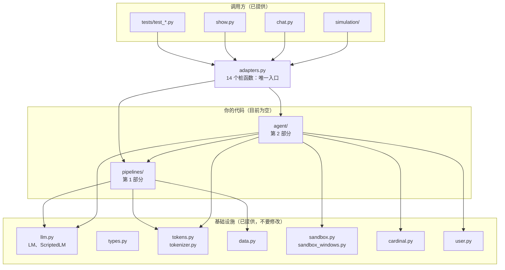
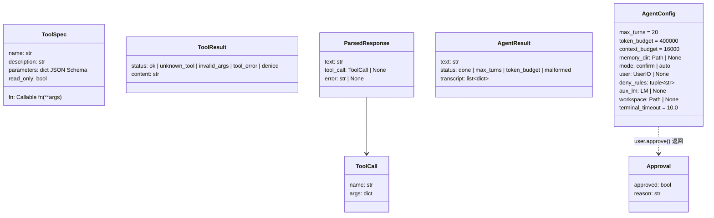
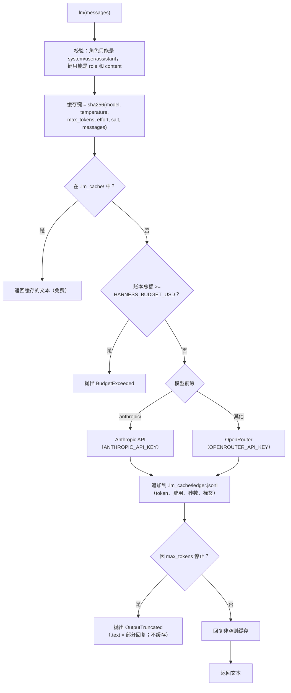
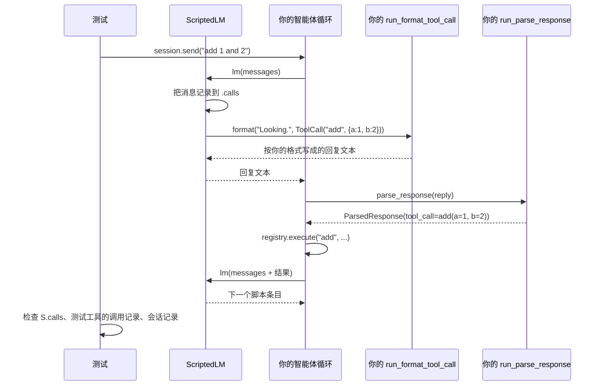
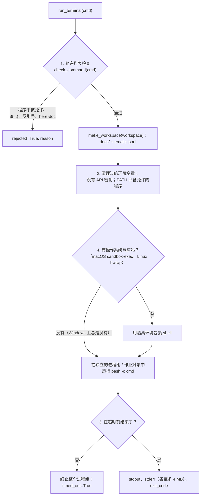
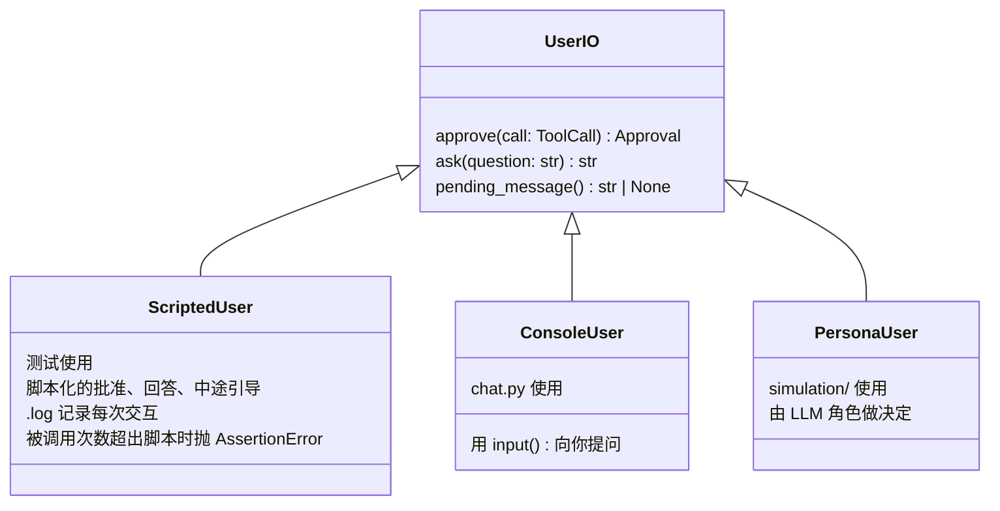
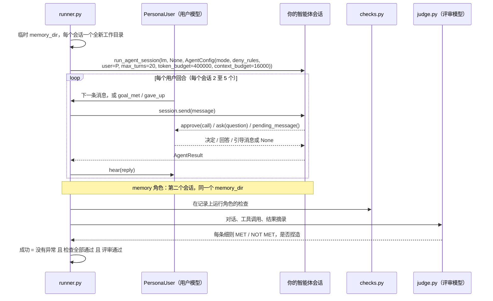
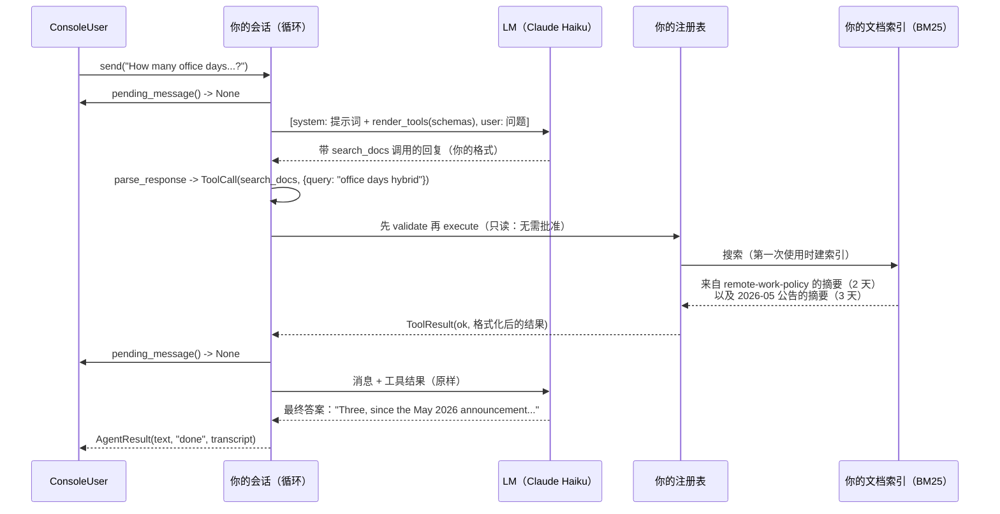

# 代码库：现有代码如何工作

> 本文是 [CODEBASE.md](CODEBASE.md) 的中文版。两者不一致时，以英文版为准。

本文解释已经存在的代码：每个模块做什么、各部分如何相互调用，以及你的代码接在哪里。
你需要构建什么，请看 [OVERVIEW.zh-CN.md](OVERVIEW.zh-CN.md)。各模块的参考表格，
请看 [GUIDE.zh-CN.md](GUIDE.zh-CN.md)。

## 目录

1. [全局视图](#1-全局视图)
2. [目录结构](#2-目录结构)
3. [adapters.py：接缝](#3-adapterspy接缝)
4. [types.py：共享的词汇](#4-typespy共享的词汇)
5. [llm.py：唯一的模型原语](#5-llmpy唯一的模型原语)
6. [tokens.py 和 tokenizer.py](#6-tokenspy-和-tokenizerpy)
7. [data.py：语料库](#7-datapy语料库)
8. [sandbox.py：终端](#8-sandboxpy终端)
9. [cardinal.py：固定的工具集](#9-cardinalpy固定的工具集)
10. [user.py：与人交互的接口](#10-userpy与人交互的接口)
11. [chat.py 和 show.py：你会运行的工具](#11-chatpy-和-showpy你会运行的工具)
12. [simulation/：最终评测](#12-simulation最终评测)
13. [tests/：测试如何驱动你的代码](#13-tests测试如何驱动你的代码)
14. [端到端：一个请求如何穿过整个系统](#14-端到端一个请求如何穿过整个系统)
15. [你的代码放在哪里](#15-你的代码放在哪里)

---

## 1. 全局视图

这个仓库是一个完整的框架，中间留了一个洞。洞周围的一切今天就能工作。这个洞就是
[harness/adapters.py](../harness/adapters.py)：14 个抛出 `NotImplementedError` 的函数，
加上空的 `pipelines/` 和 `agent/` 包。



三个理念把这个设计连在一起：

1. **一条窄窄的接缝。** 每个调用方都只通过 `adapters.py` 访问你的代码，所以你的包怎么组织
   都可以。
2. **一个模型原语。** 每个模型，无论真假，都是一个可调用对象 `lm(messages) -> str`。
   你的代码永远不知道自己拿到的是哪一种。
3. **外部的一切都有替身。** `ScriptedLM` 替代模型，`ScriptedUser` 替代人，所以大多数测试
   都离线、确定地运行。

## 2. 目录结构

```
agent-harness/
├── harness/                    Python 包
│   ├── adapters.py             接缝：14 个由你替换的桩函数              （你的）
│   ├── pipelines/              空：建议放第 1 部分                     （你的）
│   ├── agent/                  空：建议放第 2 部分                     （你的）
│   ├── types.py                接缝上的 dataclass 和 TypedDict
│   ├── llm.py                  LM（缓存、账本、预算）、ScriptedLM
│   ├── tokens.py               count_tokens、count_message_tokens
│   ├── tokenizer.py            BM25 用的 tokenize()
│   ├── data.py                 load_emails、emails_on、email_text、load_docs
│   ├── sandbox.py              run_terminal、make_workspace、jail
│   ├── sandbox_windows.py      Windows 后端：Git Bash、作业对象
│   ├── cardinal.py             10 个工具的名称、参数模式、read_only 标志
│   ├── user.py                 UserIO、ScriptedUser、ConsoleUser
│   ├── chat.py                 在终端里和你的智能体对话
│   ├── show.py                 在真实数据上运行某个第 1 部分流水线
│   └── simulation/             角色、检查、评审模型、评测运行器
├── tests/                      每个问题一个测试文件，外加测试数据
├── data/
│   ├── docs/                   24 份 Cardinal Energy 文档
│   ├── emails.jsonl.gz         压缩的归档（已提交）
│   ├── emails/emails.jsonl     解压后的归档（已加入 gitignore）
│   ├── download.py             校验 SHA-256 并解压
│   └── priority_rubric.md      打标签用的评分细则
├── docs/                       GUIDE、OVERVIEW、CODEBASE（中英文）、harness.pdf
└── 运行时生成（已加入 gitignore）：.venv/、.lm_cache/、runs/
```

## 3. adapters.py：接缝

每个适配器都有精确的类型签名，以及一段列出其测试所检查的每条规则的 docstring。
推荐的写法是函数体只有一行，调用你包里的代码：

```python
# harness/adapters.py，在你实现问题 1 之后
def run_priority(email: Email, lm: LMCallable) -> dict:
    """...（docstring 保留：它就是规格）..."""
    from harness.pipelines.priority import classify_priority
    return classify_priority(email, lm)
```

| 适配器 | 问题 | 调用方 |
|---|---|---|
| `run_priority` | 1 | 测试、`show priority`、`show digest --labels` |
| `run_daily_digest` | 2 | 测试、`show digest` |
| `run_bm25_build`、`run_bm25_search` | 3 | 测试、`show bm25`、`show email_qa`，以及问题 4 的测试 |
| `run_email_qa` | 4 | 测试、`show email_qa` |
| `run_tool_registry` | 5 | 测试 |
| `run_render_tools`、`run_parse_response` | 6 | 测试 |
| `run_format_tool_call` | 6 | 测试，经由 `ScriptedLM`（见 5.2 节） |
| `run_agent_session` | 7 至 15 | 测试、`chat.py`、`simulation/` |
| `run_build_doc_index`、`run_search_docs`、`run_read_doc` | 9 | 测试、`show search_docs` |

注意，email_qa 的实时测试用**你的** BM25 适配器构建它的 `search` 函数，所以问题 4 的实时
分数依赖于问题 3：

```python
# tests/test_email_qa.py（简化）
index = adapters.run_bm25_build([email_text(e) for e in archive])
def search(query: str, k: int = 5) -> list[dict]:
    return [archive[doc_id] for doc_id, _ in adapters.run_bm25_search(index, query, k)]
result = adapters.run_email_qa(question, search, live_lm)
```

## 4. types.py：共享的词汇

[harness/types.py](../harness/types.py) 定义了每个穿过接缝的类型。TypedDict 是普通 dict
（`email["subject"]`）；dataclass 有属性（`result.status`）。



会话记录是一个事件 dict 的列表。它是一份日志，而不是模型的上下文：压缩改变的是你发给模型
的内容，从不删除事件。

```python
{"type": "user",        "content": str}
{"type": "assistant",   "content": str}                       # 模型原始回复
{"type": "tool_call",   "name": str, "args": dict}
{"type": "tool_result", "name": str, "status": Status, "content": str}  # 与模型看到的完全一致
{"type": "error",       "content": str}                       # 出现无法解析的回复之后
# 允许其他类型（例如 "compaction"）；测试会忽略它们
```

## 5. llm.py：唯一的模型原语

### 5.1 `LM`：真实模型

```python
from harness.llm import LM
lm = LM()                      # 角色 "agent"  -> anthropic/claude-haiku-5-5
judge = LM("judge")            # 角色 "judge"  -> anthropic/claude-sonnet-5-5
lm = LM(max_tokens=8000, tag="my-experiment")
text = lm([{"role": "system", "content": "Answer in one word."},
           {"role": "user", "content": "What color is the sky?"}])
```

一次调用内部发生了什么：



| 特性 | 细节 |
|---|---|
| 角色 | `HARNESS_AGENT_MODEL`、`HARNESS_USER_MODEL`、`HARNESS_JUDGE_MODEL` 可覆盖默认值。其他任何字符串都被当作模型名。 |
| 价格检查 | `PRICES` 表中没有的模型在构造时就失败，不会产生付费调用 |
| 推理强度 | `HARNESS_REASONING_EFFORT`（默认 `low`）。隐藏推理也计入 `max_tokens`，所以 `max_tokens` 要设得宽裕。 |
| 异常 | `BudgetExceeded`（你的上限）和 `OutputTruncated`（被截断；带 `.text`）。智能体循环必须把 `OutputTruncated` 当作格式错误的回复。 |
| 用量 | `lm.usage()` 给出该实例的总计；`uv run python -m harness.llm` 按模型和标签输出账本 |
| 并发 | 可以从多个线程调用；账本写入有锁，缓存写入是原子的 |

### 5.2 `ScriptedLM`：假模型

确定性测试在你的代码需要 `lm` 的地方传入一个 `ScriptedLM`。它按脚本重放，每次调用一个条目：

```python
ScriptedLM([
    "a plain string reply",
    {"text": "Looking.", "tool_call": {"name": "add", "args": {"a": 1, "b": 2}}},
    lambda messages: "a reply computed from the messages",
])
```

脚本中的工具调用存储为名称和参数，而不是文本。为了把它变成你的解析器能读的文本，
`ScriptedLM` 会调用**你的** `run_format_tool_call`。这就是同一套测试能适用于你设计的任何调用
格式的原因：



由此有两个推论：

- **一个脚本条目 = 智能体的一个回合。** 多一次经由 `lm` 的调用（比如为了写摘要）就会消耗
  一个条目，脚本用完时抛出 `ScriptExhausted`。这就是为什么每个辅助调用都必须走
  `config.aux_lm`，测试会把它设为另一个独立的 `ScriptedLM`。
- **测试会读 `.calls`。** 它们检查你的代码发出了什么，例如工具结果是否原样出现在下一次调用中。

## 6. tokens.py 和 tokenizer.py

两个很小的模块，每个预算和每个 BM25 分数都依赖它们。

```python
count_tokens(text)            == math.ceil(len(text) / 4)
count_message_tokens(msgs)    == sum(count_tokens(m["content"]) + 4 for m in msgs)

tokenize("Re: Q3 gas-price forecast") == ["re", "q3", "gas", "price", "forecast"]
#        转为小写，然后取 [a-z0-9] 的最长连续片段
```

`count_tokens` 是一种近似（4 个字符算 1 个 token），不是提供方的分词器。项目中的每个预算
都用它：`token_budget`、`context_budget`、150 token 的摘要、1,500 token 的窗口，以及
6,000 token 的结果上限。你的代码也用同样的函数，数字才能和测试对得上。

## 7. data.py：语料库

```python
from harness import data
emails = data.load_emails()           # 26,278 个 dict，按日期排序；只读一次并缓存；不要修改
day    = data.emails_on("2001-06-22") # 该 UTC 日期邮件列表的副本，或 []
text   = data.email_text(email)       # subject + "\n" + body：BM25 索引的文本
docs   = data.load_docs()             # 24 个 dict {doc_id, title, text}，按 doc_id 排序
```

`load_emails()` 第一次使用时会读取 58 MB 的数据，需要几秒钟。这就是为什么创建智能体会话时
不能调用它（问题 8）：邮件索引要延迟构建，在某个工具第一次需要时再建。

本项目中的行号是 `text.splitlines()` 中从 1 开始的位置。`read_doc` 的窗口（问题 9）使用
同样的编号。

## 8. sandbox.py：终端

`run_terminal(cmd, *, workspace=None, timeout=10.0) -> TerminalResult` 运行一条由模型写出的
shell 命令。被拒绝或超时都不会抛异常，而是写在结果里。

```python
@dataclass
class TerminalResult:
    stdout: str = ""
    stderr: str = ""
    exit_code: int | None = None   # 被拒绝或超时时为 None
    timed_out: bool = False
    rejected: bool = False
    reason: str = ""               # 被拒绝或被终止的原因
```



| 层 | 阻止 | 不能阻止 |
|---|---|---|
| 1. 允许列表 | 不在列表中的程序、以路径形式给出的程序、`X=1 cmd`、`$(...)`、反引号、`$'...'`、here-doc | 参数：`python3`、`awk system()`、`find -exec`、`xargs` 可以运行任何东西；`> ~/x` 这类重定向 |
| 2. 清理过的环境变量 | API 密钥和其他环境变量 | 用绝对路径启动的程序 |
| 3. 超时和输出上限 | 运行时间失控；每个流超过 4 MB 的输出 | 离开进程组的进程；内存、CPU、磁盘 |
| 4. 操作系统隔离 | 网络、工作目录之外的写入、读取主目录和仓库 | **Windows 上不可用** |

允许的程序：`python3 python cat head tail grep wc sort uniq cut sed awk
tr ls find jq diff comm paste join nl tee xargs basename dirname date seq
mkdir`，以及内建命令 `cd echo printf pwd read test [ true false`。

在这台机器（Windows）上，`sandbox.jail()` 返回 `"none"`。命令在 Git for Windows 的
`bash.exe` 中运行，作业对象代替进程组，CRLF 输出会变成 LF，工作目录中的 `emails.jsonl`
是一个只读硬链接。由于 here-doc 会被拒绝，多行脚本必须写成 `python3 -c '...'`，
你的工具描述也应该这样告诉模型。

## 9. cardinal.py：固定的工具集

[harness/cardinal.py](../harness/cardinal.py) 固定了十个 Cardinal 工具中测试和角色所依赖的
部分：名称、参数模式（都带 `additionalProperties: false`）和 `read_only` 标志。描述和函数
由你提供：

```python
from harness.cardinal import cardinal_spec

def search_docs(query: str, k: int = 5) -> str:   # 给可选参数设默认值：
    ...                                            # 注册表只传入模型写出的参数

spec = cardinal_spec("search_docs", "Search the company documents. ...", search_docs)
# -> ToolSpec(name="search_docs", description=..., parameters=<固定的模式>, fn=search_docs, read_only=True)
```

只有 `run_terminal` 的 `read_only=False`，所以在 confirm 模式下它是唯一必须请求批准的工具。
`remember` 被标为只读，因为它只写入智能体自己的记忆存储。

## 10. user.py：与人交互的接口

智能体从不读键盘。它只通过 `config.user` 与人交互，这个对象有三个方法。



| 方法 | 你的智能体何时调用它 | 问题 |
|---|---|---|
| `approve(call)` | confirm 模式下，非只读调用运行之前 | 13 |
| `ask(question)` | 在 `ask_user` 工具内部 | 13 |
| `pending_message()` | 每次模型调用之前恰好一次；返回的消息会被消费掉 | 13 |

`ScriptedUser` 很严格：脚本没有预期的 `approve` 或 `ask` 会抛出 `AssertionError`，而
`steering={n: msg}` 会在第 n 次 `pending_message()` 轮询（从 0 开始计数）时送出 `msg`。
测试借此检查你是否恰好每次模型调用轮询一次。

## 11. chat.py 和 show.py：你会运行的工具

**`chat.py`** 用你的完整工具集构建一个会话，由你来扮演用户：

```python
# harness/chat.py（核心部分）
config = AgentConfig(mode=args.mode, user=ConsoleUser(),
                     memory_dir=args.memory_dir,          # 默认 .lm_cache/chat_memory
                     aux_lm=LM(tag="chat/aux"))
session = adapters.run_agent_session(LM(tag="chat"), None, config)
while True:
    result = session.send(input("you> "))
    print(result.text)
# 退出时：runs/chat-<timestamp>.json，包含回合、会话记录、用量（field_notes 需要它）
```

**`show.py`** 在真实数据上运行某个第 1 部分流水线，并打印结果和调用的费用。它调用适配器的
方式与测试完全相同。

| 命令 | 调用 |
|---|---|
| `show priority em-12167` | `run_priority` |
| `show digest 2001-06-22 --labels --limit 30` | `run_daily_digest`，然后对每封邮件调用 `run_priority`（来自缓存） |
| `show bm25 "larchfield audit"` | 在归档上调用 `run_bm25_build`（每个进程一次），然后 `run_bm25_search` |
| `show email_qa "Who leads ...?"` | 把你的 BM25 适配器包装成 `search`，然后 `run_email_qa`；打印每次搜索 |
| `show search_docs "parental leave"` | `run_build_doc_index`、`run_search_docs` |
| `show memory [DIR]` | 打印一个记忆存储的文件，或评测后每个角色的记忆存储 |

## 12. simulation/：最终评测

问题 15 的评测。它在 [harness/simulation/README.md](../harness/simulation/README.md)
中也有说明，那里列出了每种检查类型和角色文件格式。

| 文件 | 作用 |
|---|---|
| `persona.py` | 从 `tests/fixtures/personas/` 加载角色 JSON 文件 |
| `persona_user.py` | `PersonaUser`：由 LLM 扮演用户，回答 `ask_user`，决定是否批准 |
| `runner.py` | `run_persona`：构建配置、运行会话、然后打分 |
| `checks.py` | 针对会话记录的程序化检查 |
| `judge.py` | 构建评审模型看到的对话视图，并解析它的判定 |
| `record.py` | `ConversationRecord`，保存到 `runs/sim-<time>/<persona>.json` |
| `evaluate.py` | 并发运行角色、打印表格、计算分数 |
| `__main__.py` | 命令行：`--slice`、`--only`、`--rescore`、`--model`、`--salt`、`--concurrency` |

### 12.1 一次对话



`PersonaUser.approve` 按以下顺序做决定：

1. 角色文件中匹配的覆盖规则（针对调用参数的正则表达式）最先决定。
2. 否则，只读工具自动批准。
3. 否则，由角色模型根据角色写好的策略决定。

### 12.2 评审模型看到什么

评审模型从不看你的提示词，也不看模型的原始回复。它看到的是：

- 角色的职位、目标和评分细则；
- 对话：用户消息、智能体回复（至多 4,000 字符）、`ask_user` 问答、批准决定，以及中途引导
  消息；
- 每个会话至多 40 次工具调用：名称、参数（至多 300 字符）、状态，以及每个结果的
  **前 300 个字符**；
- 对于较长的结果，至多两段 200 字符、包含你的智能体所说的数字或首字母大写单词的片段。

一个具体事实如果没有工具调用支撑，就算作**捏造**，而捏造会让对话失败。所以答案的证据应当
出现在工具结果的开头，或出现在包含所述数值的片段中。

### 12.3 计分

```python
# simulation/evaluate.py
def points(successes, n=20):
    return max(0, 10 - max(0, required_successes(n) - successes))   # required = 16 * n // 20
```

## 13. tests/：测试如何驱动你的代码

| 文件 | 作用 |
|---|---|
| `test_<problem>.py` | 每个问题一个；默认是确定性测试，实时测试标有 `@pytest.mark.live` |
| `conftest.py` | fixture：`scripted(script)`、`canned_aux`、`live_lm`、`live_aux`、`archive`；`eval_slice()` 应用 `HARNESS_EVAL_SLICE` |
| `helpers.py` | `truncated(text)`（一个会抛出 `OutputTruncated` 的脚本条目）、`contains(text, alias)`（整词匹配："12" 不匹配 "120"） |
| `fixture_tools.py` | 第 2 部分的七个小工具：`echo`、`add`、`lookup`、`fail`（会抛异常）、`slow`、`big_output`、`write_note`（唯一 `read_only=False` 的）。每个都会记录自己的调用。 |
| `thresholds.py` | 实时测试的及格线 |
| `fixtures/` | 金标准标签、问题和 20 个角色 |

一个典型的第 2 部分确定性测试，节选自
[tests/test_agent_loop.py](../tests/test_agent_loop.py)：

```python
def test_tool_call_then_answer(scripted):
    # 两个智能体回合：一次 lookup 调用，然后一个普通答案
    lm = scripted([call("lookup", "Looking it up.", key="it_helpdesk"), "It is extension 4410."])
    session, fx = make_session(lm)      # 测试工具 + AgentConfig(aux_lm=canned_aux)
    result = send(session, "What is the helpdesk extension?")

    expect_status(result, "done")
    expect_lm_calls(lm, 2)
    assert fx.calls == [("lookup", {"key": "it_helpdesk"})]          # 工具运行了一次
    assert shown(lm.calls[1], DIRECTORY["it_helpdesk"])              # 它的输出出现在下一次调用中
    assert types_of(session.transcript) == ["user", "assistant", "tool_call", "tool_result", "assistant"]
```

测试检查的是从外部可见的行为（发给模型的内容、哪些工具运行了、会话记录），从不检查你的
提示词措辞。

[pyproject.toml](../pyproject.toml) 中为 `pytest` 配置了
`addopts = "-m 'not live' -q"`，所以直接运行 `uv run pytest` 会跳过 13 个实时测试。
`-m live` 则只选择它们。

## 14. 端到端：一个请求如何穿过整个系统

等你把它构建好之后，当 `chat.py` 中的用户问"混合办公团队每周要在办公室待几天？"时，
会发生这些事：



这一个请求就涉及问题 5（注册表）、6（协议）、7（循环）、8（工具集）、9（文档搜索）、
11（上下文必须放得下）和 13（轮询）。它也展示了被取代政策的陷阱：旧政策写的是两天，
后来的公告改成了三天。

## 15. 你的代码放在哪里

讲义建议第 1 部分放在 `pipelines/`，第 2 部分放在 `agent/`。下面是一种可能的布局，
你可以自由调整：

```
harness/
├── adapters.py          薄薄地调用下面的模块
├── pipelines/
│   ├── priority.py      问题 1
│   ├── digest.py        问题 2
│   ├── bm25.py          问题 3（问题 9 也会复用）
│   └── email_qa.py      问题 4
└── agent/
    ├── registry.py      问题 5
    ├── protocol.py      问题 6
    ├── session.py       问题 7、11、13、14：循环、上下文、批准
    ├── tools.py         问题 8：十个 Cardinal 工具，延迟建索引
    ├── docs_index.py    问题 9
    ├── terminal.py      问题 10：围绕 sandbox.run_terminal 的观察策略
    └── memory.py        问题 12
```

提供的代码对你的代码有这些期望：

- **只从包内部 import**（以及允许的库）。
- **辅助工作绝不调用 `lm`**；用 `config.aux_lm or lm`。
- **创建会话时绝不调用 `data.load_emails()`。**
- **用锁保护共享的索引**，因为实时测试会从多个线程调用。
- **只通过 `sandbox.run_terminal` 运行命令。**
- **不要在提示词和工具结果中放绝对路径**，这样缓存才能在多次评测之间继续有效。
