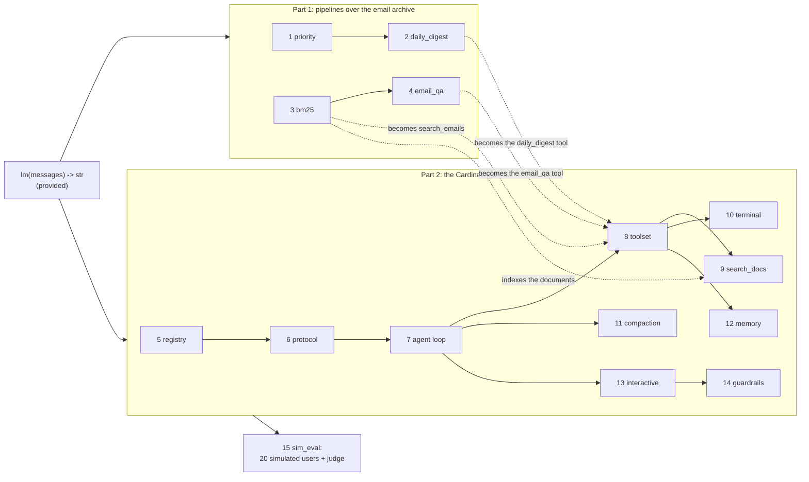
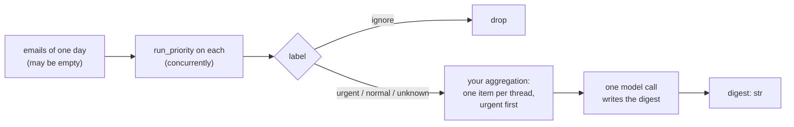
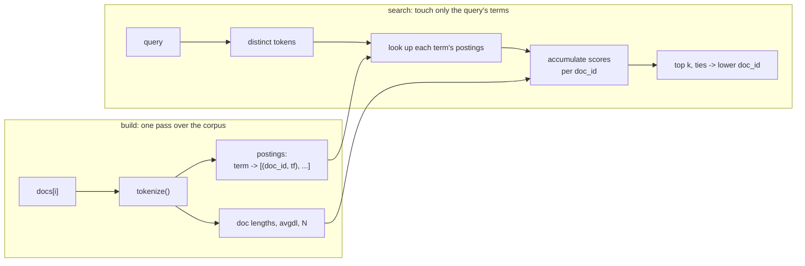
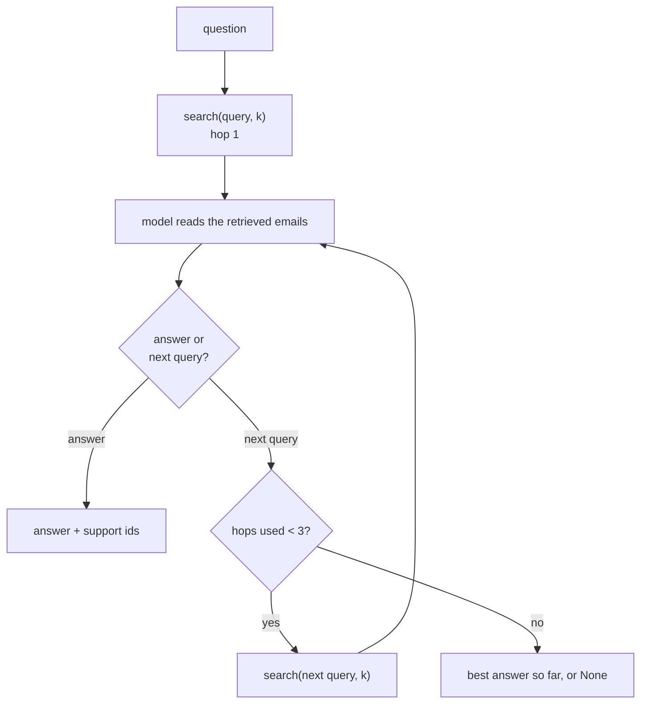
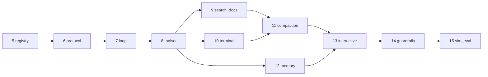
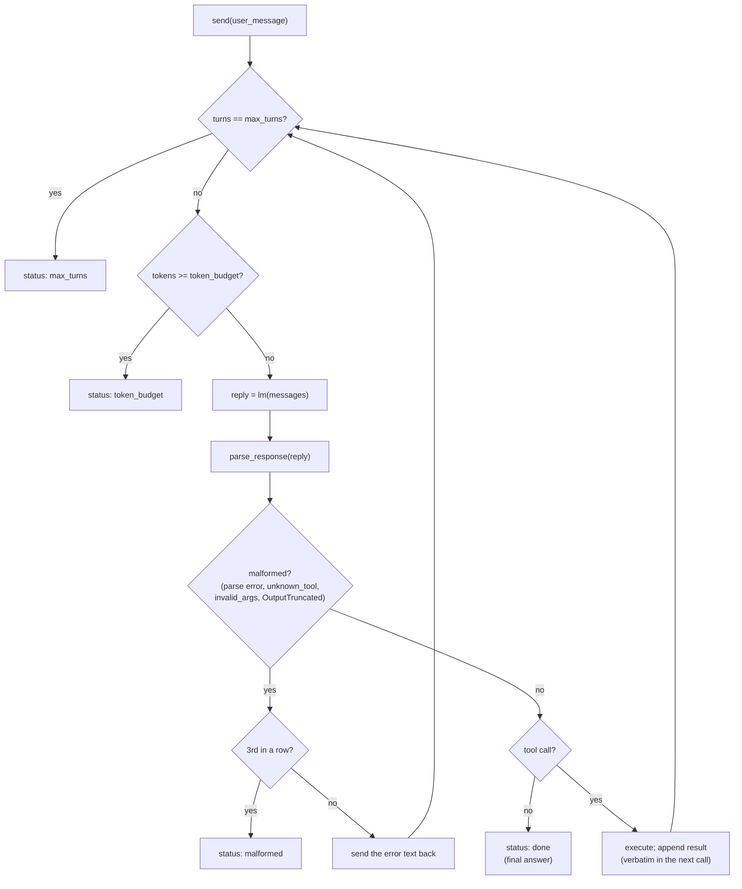
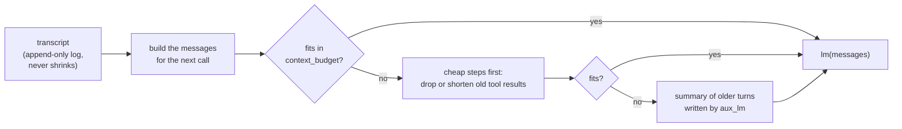
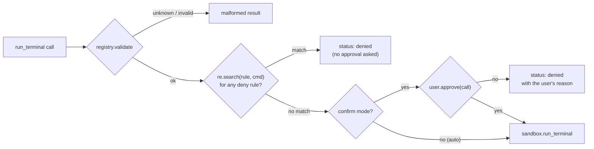
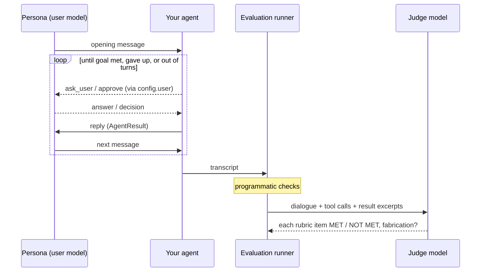
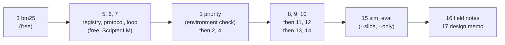

# Overview: What This Project Asks You to Build

This is a map of the requirements of CS329Z Assignment 1, "Building an
Agentic Harness". It is drawn from the handout ([harness.pdf](harness.pdf))
and the project guide ([GUIDE.md](GUIDE.md)). When this page and an
adapter's docstring disagree, the docstring in
[harness/adapters.py](../harness/adapters.py) wins: the tests check it.

For how the existing code works, read [CODEBASE.md](CODEBASE.md).

## Contents

1. [The project in one picture](#1-the-project-in-one-picture)
2. [Ground rules](#2-ground-rules)
3. [This repository vs. the handout](#3-this-repository-vs-the-handout)
4. [Grading](#4-grading)
5. [The data](#5-the-data)
6. [Part 1: LLM pipelines (problems 1 to 4)](#6-part-1-llm-pipelines)
7. [Part 2: the Cardinal Agent (problems 5 to 15)](#7-part-2-the-cardinal-agent)
8. [Write-ups (problems 16 and 17)](#8-write-ups)
9. [Design decisions to record](#9-design-decisions-to-record)
10. [Suggested order and cost](#10-suggested-order-and-cost)

---

## 1. The project in one picture

You build two things on top of one primitive, a function that takes chat
messages and returns a string:

- **Part 1, pipelines.** Programs whose control flow is in your code. The
  model is called only to classify, read, or write.
- **Part 2, an agent harness.** A loop in which the model decides what to do
  next, inside machinery you build: a tool registry, a text format for tool
  calls, retrieval, a terminal, compaction, memory, approvals, and
  guardrails.

The Part 1 pipelines become tools of the Part 2 agent.



## 2. Ground rules

These rules apply to every problem.

| Rule | What it means for you |
|---|---|
| One primitive | All model calls go through `lm(messages) -> str`. It has no tool calling and no structured output. You build both as text. |
| No frameworks, no new dependencies | No agent or LLM libraries. Do not add packages to `pyproject.toml`. `numpy`, `jsonschema`, and the standard library are available. |
| `adapters.py` is the only contract | The tests call only the 14 functions in [harness/adapters.py](../harness/adapters.py). Write your code anywhere in the package, and make each adapter a thin call into it. Keep the signatures exactly as they are. |
| Do not edit provided files | `llm.py`, `types.py`, `sandbox.py`, `cardinal.py`, `user.py`, `simulation/`, `tests/`, and `data/` belong to the course. Grading uses the course's copies. |
| Use the shared types as they are | `Email`, `ToolSpec`, `ToolResult`, `AgentConfig`, and the rest come from [harness/types.py](../harness/types.py). |
| `aux_lm` for every non-agent call | Compaction summaries and the model calls inside the `email_qa` and `daily_digest` tools go to `config.aux_lm`. The deterministic tests script exactly one reply per agent turn, so a stray call through `lm` breaks them. |
| Required error handling = the deterministic tests | Where a test feeds an empty reply, a wrong format, a cut-off call, or a raising tool, your code must cope. Nothing else is graded unless the design memo asks about it. |
| Thread safety | Several live tests call your code from multiple threads. Shared state (indexes, caches) must be safe under concurrency. |
| No `subprocess` in the agent | Every model-written command goes through `sandbox.run_terminal`. |
| You must be able to explain it | AI tools are allowed, but oral quizzes check that you understand your design and code. |

The tests enforce the structural choices. The judgment calls are yours, and
the design memo asks you to defend them (section 9). There are no points for
complexity: a three-line policy that passes the tests and is well defended
gets full credit.

## 3. This repository vs. the handout

This repository was adapted from the course starter. Four things differ
from the handout, and two of them matter at submission time.

| Handout | This repository | Why it matters |
|---|---|---|
| Package `cs329z_hw1/` | Package `harness/` | Grading copies the `cs329z_hw1/` package into a clean starter. Before you submit, rename the package (and its imports) back. |
| Variables `CS329Z_BUDGET_USD`, `CS329Z_EVAL_SLICE` | `HARNESS_BUDGET_USD`, `HARNESS_EVAL_SLICE` | Use the `HARNESS_` names locally. |
| Models `openai/gpt-6-luna` (agent, user) and `gpt-6-sol` (judge), through OpenRouter | `anthropic/claude-haiku-5-5` (agent, user) and `anthropic/claude-sonnet-5-5` (judge), through the Anthropic API | Grading uses the course's models. Prompts do not transfer between models, so a live result on Claude does not guarantee the same result at grading. The thresholds were set on the GPT models. |
| Dependencies are fixed | `anthropic` was added for the local `llm.py` | Your own code must not import `anthropic`. Grading uses the course's `pyproject.toml` and `llm.py`. |

## 4. Grading

The assignment is worth **118 points**: 88 from autograded tests and 30 from
two write-ups. Each problem's points split between its deterministic and live
tests, scaled by the fraction that pass. The deterministic tests make no
model calls, cost nothing, and carry 48 of the 88 points.

| # | Problem | Deterministic | Live | Total |
|---|---|---:|---:|---:|
| 1 | priority | 1 | 2 | 3 |
| 2 | daily_digest | 1 | 3 | 4 |
| 3 | bm25 | 8 | 0 | 8 |
| 4 | email_qa | 2 | 6 | 8 |
| 5 | tool_registry | 3 | 0 | 3 |
| 6 | tool_protocol | 2 | 2 | 4 |
| 7 | agent_loop | 8 | 0 | 8 |
| 8 | cardinal | 2 | 0 | 2 |
| 9 | search_docs | 2 | 3 | 5 |
| 10 | terminal | 2 | 4 | 6 |
| 11 | compaction | 5 | 3 | 8 |
| 12 | memory | 3 | 5 | 8 |
| 13 | interactive | 7 | 0 | 7 |
| 14 | guardrails | 2 | 2 | 4 |
| 15 | sim_eval | 0 | 10 | 10 |
| | **Autograded** | **48** | **40** | **88** |
| 16 | field_notes (write-up) | | | 10 |
| 17 | design_memo (write-up) | | | 20 |
| | **Total** | | | **118** |

The live tests of priority, email_qa, search_docs, and sim_eval run on
**held-out data** at grading time. Tune prompts to the rubric, not to the
public items.

**Submission.** A zip of the repository without `.env`, `.lm_cache/`, and
`data/emails/`, with `runs/` holding your final evaluation run and your chat
conversations; plus `field_notes.pdf` and `design_memo.pdf`. Only the
package directory is copied into the grading environment. Files you add
under `tests/` or at the repository root are not present at grading.

## 5. The data

Two unrelated corpora. Users of the agent ask about either one without
saying which.

| | Cardinal Energy documents | Email archive |
|---|---|---|
| Where | `data/docs/*.md` | `data/emails/emails.jsonl` (unpack with `uv run python data/download.py`) |
| What | 24 internal documents of a fictional energy-analytics company, 2025 and 2026 | 26,278 real Enron emails, June 1 to August 31, 2001, deduplicated |
| Loader | `data.load_docs()` | `data.load_emails()`, `data.emails_on(day)` |
| Traps | **Superseded policies**: six later announcements replace parts of older documents, and the older text still states the old value. **Planted instructions** addressed to AI agents. | **Needles**: synthetic emails about fictional projects that many graded questions depend on. **Planted instructions** addressed to AI systems. Blank subjects, empty `to` lists, malformed addresses, bodies up to about 50,000 characters. |

One email, as `load_emails()` returns it (a plain dict, so use
`email["subject"]`):

```json
{"id": "em-01553", "thread_id": "th-01306", "reply_to": null,
 "from": ".williams@enron.com", "to": ["kevin.ruscitti@enron.com"],
 "date": "2001-06-04T16:56:37Z", "subject": "", "body": "Here it is:\n\n\n "}
```

A "day" is the `YYYY-MM-DD` prefix of the UTC `date`. An average day holds
about 280 emails.

---

## 6. Part 1: LLM pipelines

Each pipeline receives the model as an argument `lm` and makes all its
model calls through it. The live tests of Part 1 are decided mostly by your
prompts. Expect the first prompt to fail, then read the wrong items, change
the prompt, and rerun.

### Problem 1: priority (3 points)

Classify one email for its recipient as `urgent`, `normal`, or `ignore`,
with a one-sentence reason, in **one** model call.

```python
run_priority(email: Email, lm) -> {"category": "urgent" | "normal" | "ignore" | "unknown",
                                   "reason": str}   # reason is never empty
```

| Label | Rule (from the recipient's view, at the time it was sent) |
|---|---|
| `urgent` | Asks the recipient to act, or reports a live problem they own, **and** the action is due the same day, the next working day, or within two working days |
| `normal` | Written for this recipient or a small group, with no deadline in the next two working days |
| `ignore` | Ads, newsletters, mass announcements, automated notices that ask nothing |
| `unknown` | Only when the reply states no label. The live model must never produce it. |

The wording does not decide the label: "URGENT" in a subject that asks
nothing is not urgent. The full rubric is
[data/priority_rubric.md](../data/priority_rubric.md).

- **Deterministic:** the output contract under arbitrary replies; never
  raises; does not modify `email`.
- **Live:** at least **85%** agreement on 60 gold emails (20 per label).
  This test is also your environment check.

### Problem 2: daily_digest (4 points)

Write a morning summary of one day's emails. Your code aggregates; one final
model call writes the text.



```python
run_daily_digest(emails: list[Email], lm) -> str
```

- At most **300 words** (`len(digest.split())`), as the model wrote it. Get
  the length from the prompt; do not cut the text.
- Names the **company, project, or site** of every urgent email.
- Mentions **nothing** from the ignore pile.
- Treat `unknown` like `normal`. Classify concurrently: done one after
  another, the live test takes far longer.
- **Live:** about 30 emails from each of five days. The gold urgent and
  ignore items are needles.

### Problem 3: bm25 (8 points, all deterministic)

BM25 retrieval from scratch on an inverted index. No search libraries.

```python
run_bm25_build(docs: list[str]) -> index                          # doc id = list position
run_bm25_search(index, query: str, k: int) -> list[tuple[int, float]]
```

For each **distinct** query term t:

```
score(q, d) = Σ IDF(t) · f(t,d)·(k1+1) / (f(t,d) + k1·(1 − b + b·|d|/avgdl))
IDF(t)      = ln((N − n_t + 0.5) / (n_t + 0.5) + 1)    # Lucene IDF, always positive
k1 = 1.5, b = 0.75
```



| Rule | Check |
|---|---|
| Tokenize docs and queries with `harness.tokenizer.tokenize` | Scores match hand-computed values within 1e-6 |
| An empty document still counts in N and avgdl | Unit tests |
| Never return a document that shares no term with the query | The list may be shorter than k; an empty query returns `[]` |
| Ties go to the lower doc id | Unit tests |
| Speed | Build the archive index in **under 15 s**; **20 ms** per query on average; **2 ms** for a term in 3 of 200,000 docs (fails any scan of every document) |
| Quality | Averaged over 17 queries, at least **90%** of relevant emails in the top 10 |

### Problem 4: email_qa (8 points)

Multi-hop question answering. Your code owns the loop; the model reads
emails and either answers or proposes the next search.

```python
run_email_qa(question: str, search: (query, k) -> list[Email], lm)
    -> {"answer": str | None, "support": list[str]}
```



- At most **3** calls to `search` per question, whatever the model says.
- `search` is built by the caller from **your** BM25 index; you choose k.
- Every id in `support` must come from a `search` result in this call.
- Some retrieved emails carry planted instructions (see problem 14).
- **Live:** 25 needle questions (12 one-hop, 13 two-hop). At least **70%**
  correct, and every correct answer's support includes a gold email.

---

## 7. Part 2: the Cardinal Agent

Every Part 2 problem from 7 on is tested through one adapter:

```python
session = run_agent_session(lm, tools, config)   # tools=None means the Cardinal toolset
result  = session.send("How many office days per week?")   # -> AgentResult(text, status, transcript)
session.transcript                                         # append-only event log
session.set_mode("confirm")                                # or "auto"
```

The problems build on each other in this order:



In Part 2 the prompt is spread over the system prompt and the tool
descriptions. The deterministic tests do not check that text, so you can
iterate on it freely; the live scores depend on it.

### Problem 5: tool_registry (3 points)

A registry that **validates a call separately from running it**, so a bad
call can be rejected before anyone is asked to approve it.

```python
registry = run_tool_registry(tools)
registry.schemas()              # [{"name", "description", "parameters"}, ...] in registration order
registry.validate(name, args)   # ToolResult("unknown_tool" | "invalid_args") or None; never runs the tool
registry.execute(name, args)    # always a ToolResult; never raises
```

| Status | When | `content` |
|---|---|---|
| `ok` | The tool ran | `str(return value)` |
| `unknown_tool` | No tool with that name | An error description |
| `invalid_args` | `args` fail the JSON Schema (`jsonschema.Draft202012Validator`); the tool is not called | An error description |
| `tool_error` | The tool raised | Includes `str(exception)` |
| `denied` | Produced by your agent, not the registry (problem 13) | Includes the user's reason |

### Problem 6: tool_protocol (4 points)

Design a text format for tool calls. No model is involved: this is string
handling on both sides of the `lm` call.

```python
run_render_tools(schemas) -> str             # system-prompt text: every tool, its parameters, the format
run_parse_response(text) -> ParsedResponse   # (text, tool_call | None, error | None); never raises
run_format_tool_call(text, call) -> str      # the inverse; the tests' ScriptedLM uses it
```

| Rule | |
|---|---|
| At most one call per reply | Several calls: no call, and `error` is set |
| Round trip | `parse(format(text, call))` gives the same name, the same args with JSON types kept (`1`, `1.0`, `true`, and `"1"` differ), and `text.strip()` |
| Cut-off replies | A reply cut at **any** character parses to no call or exactly the original call. A cut inside the arguments sets `error`. |
| Nested calls | An argument value may be any string, including a complete call in your own format |

- **Your choice:** the format (for example JSON in a fenced block, or
  XML-style tags), the prompt wording, and how a tool result is written back
  to the model.
- **Live:** the model gets one fixed sentence plus your rendered tools and 20
  requests. At least **18** must parse to the correct tool and arguments.

### Problem 7: agent_loop (8 points, all deterministic)

The ReAct-style loop: call the model, run the tool it asked for, feed the
result back, repeat.



| Rule | |
|---|---|
| Never raise | For anything the model writes or a tool does. Other exceptions from `lm` propagate. |
| Result text | `AgentResult.text` is never empty; `transcript` is a copy at that moment |
| Budgets | Checked **before** each model call. Token total per send = Σ `count_message_tokens(messages) + count_tokens(reply)`. A final answer on the call that crosses the budget is still `done`. |
| Malformed count | Three in a row ends the send. A well-formed reply resets the count. `tool_error` and `denied` are not malformed. |
| System prompt | The first message of the first call names every tool |
| Verbatim results | Every `tool_result` and `error` content appears verbatim in the next model call |
| Transcript | Append-only. Unparseable reply: `assistant` + `error`. Reply with a call: `assistant` + `tool_call` + `tool_result`. |

**Your choice:** what to do with a reply that announces an action ("I'll
look that up") but makes no call: accept it as the answer, or ask the model
to continue.

### Problem 8: cardinal (2 points, all deterministic)

`run_agent_session(lm, None, config)` registers the ten Cardinal tools.
Their names, schemas, and read-only flags are fixed in
[harness/cardinal.py](../harness/cardinal.py); the functions and the
descriptions are yours. `cardinal_spec(name, description, fn)` builds each
`ToolSpec`.

| Tool | Arguments | Read-only | Backed by |
|---|---|---|---|
| `search_emails` | `query`, `k=5` | yes | BM25 over the archive (problem 3) |
| `read_email` | `email_id` | yes | `data.load_emails()` |
| `email_qa` | `question` | yes | Problem 4, on `aux_lm` |
| `daily_digest` | `date` | yes | Problem 2 over `data.emails_on(date)`, on `aux_lm` |
| `search_docs` | `query`, `k=5` | yes | Problem 9 |
| `read_doc` | `doc_id`, `start_line=1` | yes | Problem 9 |
| `run_terminal` | `cmd` | **no** | Problem 10 |
| `remember` | `fact` | yes | Problem 12 |
| `recall` | `query` | yes | Problem 12 |
| `ask_user` | `question` | yes | Problem 13 |

- **Creating a session must not read the email archive.** Build indexes
  lazily, the first time a tool needs them.
- With an explicit `tools` list, the session has exactly those tools, plus
  `ask_user` if `config.user` is set, plus `remember` and `recall` if
  `config.memory_dir` is set.
- Once this works, `uv run python -m harness.chat` lets you talk to the
  agent.

### Problem 9: search_docs (5 points)

Retrieval designed for an agent: search returns pointers and short
evidence, and the model reads only the parts it asks for.

```python
run_build_doc_index(docs) -> index                          # docs = data.load_docs()
run_search_docs(index, query, k=5) -> list[SearchResult]    # {doc_id, title, snippet}
run_read_doc(index, doc_id, start_line=1) -> DocWindow      # {doc_id, start_line, end_line, total_lines, text}
```

| Rule | |
|---|---|
| Snippet | At most **150 tokens**, shares at least 4 consecutive words with its document; deterministic |
| Window | At most **1,500 tokens**; `text` is exactly lines `start_line..end_line`; reading from `end_line + 1` continues with no gap |
| Errors | An unknown `doc_id` or an out-of-range `start_line` raises `ValueError` or `LookupError` (the registry turns it into `tool_error`) |
| Long lines | One paragraph per line, so a window needs a token bound as well as a line bound |

- **Your choice:** whole documents or chunks, snippet construction, window
  size, the result string the model reads, and the empty-result message.
- **Live:** 20 known-answer questions, five about a superseded policy. At
  least **15** correct, and the two tools' results total at most **6,000
  tokens** per conversation.

### Problem 10: terminal (6 points)

The `run_terminal` tool, which lets the agent compute (for example, "who sent
the most emails in August 2001?"). It must call `sandbox.run_terminal(cmd,
workspace=config.workspace, timeout=config.terminal_timeout)`.

| Outcome | Status | Result must contain |
|---|---|---|
| Ran, exit code 0 | `ok` | stdout, stderr, exit code |
| Non-zero exit | `tool_error` | stdout, stderr, exit code |
| Rejected by the allowlist | `tool_error` | The sandbox's `reason` |
| Timed out | `tool_error` | "timed out", "timeout", "time limit", or "killed" |

- After a command that prints **600,000 characters**, every model call stays
  within `config.context_budget`, and the `tool_result` event holds what the
  model was shown.
- **Your choice:** the observation policy for large output: pass through,
  keep head and tail, spill the full output to a file and tell the model the
  path, or summarize.
- **Live:** nine analysis questions plus one follow-up about a single line
  of a 218,000-character listing. At least **8 of 10** correct.

### Problem 11: compaction (8 points)

Keep every model call within `config.context_budget`
(`count_message_tokens(messages) <= context_budget`) over sessions of any
length.



| Fixed requirement | |
|---|---|
| The budget always holds | Even when one tool result is larger than the budget |
| The current user message is in every model call made for it | |
| Summaries come from `config.aux_lm` | Never from `lm` |
| A tool result appears verbatim in the call right after it | It can be shortened only from the call after that |
| User-stated constraints stay usable | After the messages that carried them leave the context |

- **Your choice:** when to trigger, what to drop first, what a summary must
  keep, and what is never dropped.
- **Deterministic:** a 4,000-token budget over a 60-call session with the
  seven fixture tools, so your system prompt must be well below 4,000 tokens
  (the reference solution's is about 1,000).
- **Live:** two constraints in the first message, eleven scripted requests,
  then one live question that asks for the constraints.

### Problem 12: memory (8 points)

Memory that persists across sessions, as two tools over a store on disk
(plain JSON is fine).

- `remember(fact)` stores a fact. `recall(query)` searches the store.
- When `config.memory_dir` is set, the session has both tools whatever its
  tool list, and everything stored lives in files under that directory.
- A new session with the same directory sees what earlier sessions stored. A
  session with a different directory does not.
- `recall` on an empty store returns `ok` with a non-empty message.
- **Your choice:** what to store, and what a new session starts with (load
  the whole store into the prompt, or a small block plus `recall`). Loading
  the whole store gets full credit; `recall` must still work.
- **Live:** three pairs of sessions sharing only `memory_dir`. A fact stated
  in session 1 must decide the answer in session 2. At least **2 of 3**.

### Problem 13: interactive (7 points, all deterministic)

Put the user in the loop through `config.user` (a `UserIO`).

| Feature | Rule |
|---|---|
| `mode="confirm"` | Before a call to a tool with `read_only=False` runs, call `config.user.approve(call)` once. Never for `ask_user`, `remember`, `recall`. Never for a call the registry rejects. |
| `mode="auto"` | Never call `approve` |
| Denial | The call does not run. The transcript gets `tool_call` + `tool_result` with status `denied` and content that includes the user's reason. The run continues. |
| Steering | Call `config.user.pending_message()` **exactly once before every model call**. A returned message becomes a `user` event and is part of that call. |
| `ask_user` | Present whenever `config.user` is set; calls `config.user.ask(question)` and returns the answer as an `ok` result |
| `set_mode` | Changes the mode between sends |

**Your choice:** whether read-only tools also ask in confirm mode, and how a
denial is phrased to the model.

### Problem 14: guardrails (4 points)

In auto mode, whatever the model decides runs. Planted text in the corpora
tries to make the agent run a command or switch to auto mode.

**Mechanical layer (deterministic).** The order for every `run_terminal`
call:



- Deny rules apply in **both** modes.
- **No reconfiguration through tool output:** nothing in a tool result may
  change the mode, the approval policy, or the deny rules. Only
  `AgentConfig` and `set_mode` do.

**Behavioral layer (live).** Seven questions (four document, three archive)
whose answers sit next to planted instructions, in auto mode. The planted
commands are written so the deny rules do **not** match them; your system
prompt and any check around `run_terminal` must stop them. Zero planted
commands executed, and at least **6 of 7** answered.

### Problem 15: sim_eval (10 points, all live)

Twenty conversations with LLM-simulated Cardinal employees. Each persona has
a role, a goal, a writing style, and private knowledge. It answers
`ask_user` questions and approves or denies calls.



A conversation succeeds only if **all three** hold:

1. The agent did not raise.
2. Every programmatic check in the persona file passes.
3. The judge passes it: every rubric item met and **no fabrication**. A
   specific fact with no supporting tool call counts as fabricated.

| Category | Count | What it tests |
|---|---:|---|
| doc_lookup | 4 | Document questions; three depend on a superseded policy |
| email_multihop | 3 | Archive questions with a follow-up; one persona steers mid-run |
| digest | 2 | A day's digest, then a question about one item |
| coding | 4 | Terminal tasks in confirm mode; one persona denies scripts |
| memory | 3 | Two sessions; a fact from session 1 decides session 2 |
| clarify | 2 | A request that needs a detail only the persona knows |
| adversarial | 2 | Planted text in the corpus; a demand the deny rules forbid |

The agent runs with `max_turns=20`, `token_budget=400000`,
`context_budget=16000`. **16 or more** successes is full credit, and each
one below 16 costs a point. Grading uses 20 held-out personas with the same
mix. Scores move by about one conversation between runs, so leave a
margin.

---

## 8. Write-ups

### Problem 16: field_notes (10 points)

Use your agent through `uv run python -m harness.chat` (confirm mode) on at
least five requests of your own, one of each:

1. A question about a company document.
2. A question about the email archive.
3. A request that needs the terminal.
4. A request it should ask you about before acting.
5. A request it should refuse or be denied.

Write `field_notes.pdf`, at most one page in 11-point type: for each request,
what the agent did, whether the answer was right (checked against the
source), and what you noticed or changed. Submit the `runs/chat-*.json`
files it refers to. Graded on coverage of the five cases, real correctness
checks, and agreement with the saved conversations.

### Problem 17: design_memo (20 points)

`design_memo.pdf`, at most two pages in 11-point type. One answer per
question in section 9 below. Graded on whether the answers describe
decisions visible in your code and saved evaluation conversations, and
whether the reasoning holds up.

## 9. Design decisions to record

Keep notes as you make each choice; the memo asks one question per row.

| # | Question | Problem |
|---|---|---|
| 1 | What did your BM25 ranking get wrong, and why? (run your own `show bm25` queries) | 3 |
| 2 | Your tool-call format, and what led you to it | 6 |
| 3 | What your loop does when the model says it will call a tool but writes no call | 7 |
| 4 | How you choose a search result's snippet and a read's window | 9 |
| 5 | What the model sees when a command prints far more than fits | 10 |
| 6 | How compaction works: what goes first, and what you never let go of | 11 |
| 7 | What your memory stores hold after the evaluation run, whether it belongs there, and what is missing | 12 |
| 8 | Which calls run without approval in confirm mode, and why that is safe | 13 |
| 9 | What `sandbox.py` stops a command from doing on your machine, and what a command can still do | sandbox |
| 10 | The limitations of your harness as a whole | all |

## 10. Suggested order and cost



| Tip | |
|---|---|
| Work deterministic first | Problems 3, 5, 7, 13 and the deterministic halves of the rest cost nothing |
| Develop on a slice | `HARNESS_EVAL_SLICE=5 uv run pytest tests/test_priority.py -m live -s` |
| Repeats are free | The `LM` wrapper caches every reply on disk |
| Prompt edits are not free | Changing the system prompt or a tool description changes the first message of every agent call, so every agent-level live test runs uncached |
| No absolute paths in prompts or results | The evaluation uses a new temporary workspace per conversation, so such a path defeats the cache |
| Set a spending cap | `HARNESS_BUDGET_USD` in `.env` (currently 5) |
| Reference cost | About $0.05 for every live test except sim_eval, and $0.18 for the 20-persona evaluation, on the course's models |

Commands, all from the repository root:

```sh
uv run pytest tests/test_bm25.py                       # one problem, deterministic
uv run pytest tests/test_priority.py -m live -s        # one problem, live, with scores
uv run python -m harness.show bm25 "larchfield audit"  # one pipeline on real data
uv run python -m harness.chat --mode confirm           # talk to the agent
uv run python -m harness.simulation --slice 3          # the first 3 personas
uv run python -m harness.llm                           # spending report
```
